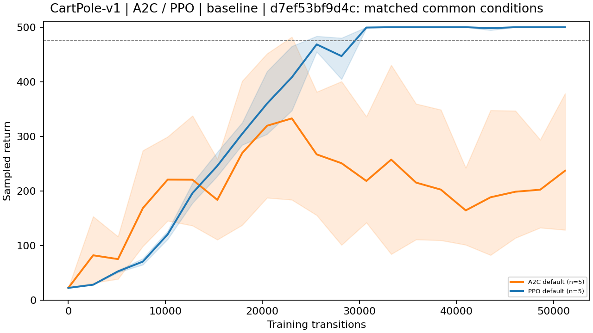
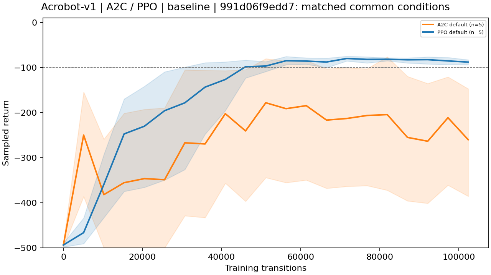
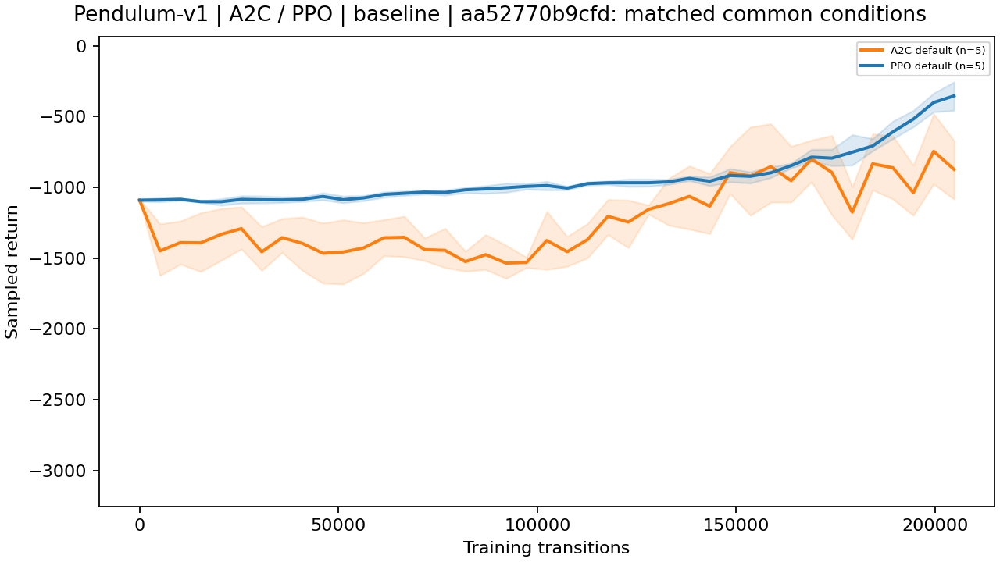
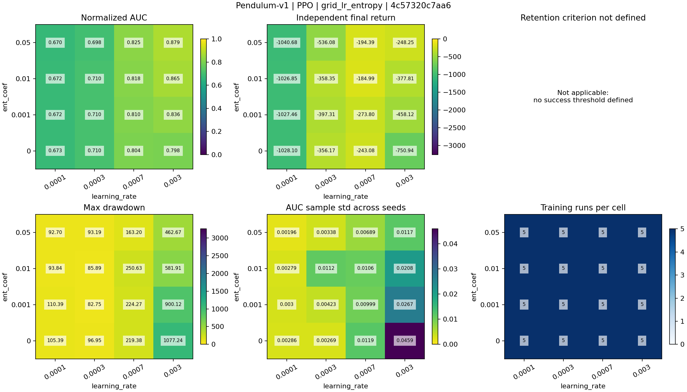

# Результаты основного поискового этапа A2C/PPO

**Назначение:** содержательный разбор для обсуждения статьи. **Статус на 25 октября
2026 года:** поисковый этап завершён, подтверждающий ещё не выполнен. Первичный разбор
выполнен 24 октября; при обновлении документации анализ повторно сформирован из тех же
обучений. Протокол — [MAIN_STUDY.md](MAIN_STUDY.md), определения —
[METHODOLOGY.md](METHODOLOGY.md).

Источник: локальный results_search; план:
configs/main_search_v1.json, SHA-256
ce985c2020e503411d9ebb8a2108766f79c46c47e2bc026cd0c45f64d529d19e.
Обучение не повторялось, новые серии не запускались. При обновлении документации
исправлены только подписи рисунков и текст автоматического отчёта; численные
таблицы сверены с предыдущим анализом. Снимок для чтения без исходных моделей —
[data/main_search_v1/](data/main_search_v1/).

**Полнота и согласованность данных**

- Выполнены все 1 620 позиций плана: по 270 на каждую пару среда–алгоритм.
- Все 324 позиции конфигураций имеют пять seed, все 192 ячейки сеток заполнены.
- Пропусков, незавершённых запусков, несовместимых версий и повреждённых артефактов нет.
- 175 дополнительных запусков CartPole сохранены и исключены из основного анализа.
- Различных условий с учётом seed — 1 080. Для 300 условий есть повторные записи
  в нескольких сериях; расхождений AUC, финальной награды и максимальной просадки
  между этими записями не найдено. Повторы не увеличивают независимую выборку.
- Числа runs.csv сверены с метриками, заново прочитанными из исходных результатов;
  средние summary.csv сверены с runs.csv. Расхождений не найдено.
- Версия кода анализа совпадает с analysis_source_sha256 сохранённого отчёта.

Бюджеты: CartPole 51 200, Acrobot 102 400, Pendulum 204 800 переходов.
Все выводы относятся к этим бюджетам и реализациям SB3. Полная сходимость не установлена.

**Стандартные настройки алгоритмов (baseline)**

Здесь и далее ± обозначает выборочное стандартное отклонение между пятью обучениями,
а не доверительный интервал и не разброс отдельных оценочных эпизодов. Финальная
награда получена отдельной sampled-оценкой, не участвовавшей в периодических оценках.
Для отрицательных наград более высокое значение, ближе к нулю, лучше.

| Среда | A2C: финальная награда | PPO: финальная награда | A2C: средняя максимальная просадка | PPO: средняя максимальная просадка |
|---|---:|---:|---:|---:|
| CartPole | 235,4 ± 158,5 | 497,9 ± 4,8 | 323,3 | 45,1 |
| Acrobot | −247,7 ± 161,0 | −84,8 ± 2,0 | 221,6 | 17,2 |
| Pendulum | −850,0 ± 233,7 | −356,2 ± 120,2 | 730,9 | 96,9 |

PPO имеет более высокую итоговую награду, меньший её межзапусковый разброс и меньшую
среднюю максимальную просадку во всех трёх baseline-сравнениях.

Bootstrap 95% интервалы разности итоговых наград A2C − PPO:

- CartPole: −262,5, интервал [−369,5; −125,9].
- Acrobot: −162,9, интервал [−296,8; −52,5].
- Pendulum: −493,9, интервал [−670,2; −267,2].

Все три интервала находятся ниже нуля. Это поисковые оценки на пяти seed;
их нельзя представлять как окончательное подтверждение общего превосходства алгоритма.
Для разности AUC на Acrobot интервал [−0,462; 0,037] включает ноль, поэтому вывод
о различии AUC там менее определён, чем вывод по итоговой награде и просадкам.

В CartPole A2C подтвердил порог в 2/5 запусках, но удержал его в последних двух
контрольных точках в 0/5; PPO — 5/5 и 5/5 соответственно. В Acrobot эти числа
составляют 3/5 и 1/5 для A2C, 5/5 и 4/5 для PPO. Отдельная финальная оценка выше
порога у 1/5 A2C и 5/5 PPO в обеих дискретных средах. Удержание по двум контрольным
точкам и независимая финальная оценка — разные показатели.

Для Pendulum порог не задан, поэтому доли решения, удержания и срыва не рассчитываются.
На baseline-кривых Pendulum в конце бюджета сохраняется улучшение; называть этот
бюджет доказанным временем сходимости нельзя.

**Чувствительность к гиперпараметрам**

Показатель ниже — размах средних нормированных AUC по объявленным значениям одного
параметра: максимум минус минимум. Это изменение качества при смене настройки;
оно отличается от разброса между seed при фиксированной настройке. Диапазоны
learning_rate, ent_coef и gae_lambda совпадают у двух алгоритмов.

| Среда | Алгоритм | Размах AUC: learning_rate | Размах AUC: ent_coef | Размах AUC: gae_lambda |
|---|---|---:|---:|---:|
| CartPole | A2C | 0,447 | 0,334 | 0,111 |
| CartPole | PPO | 0,731 | 0,052 | 0,127 |
| Acrobot | A2C | 0,632 | 0,465 | 0,119 |
| Acrobot | PPO | 0,444 | 0,087 | 0,365 |
| Pendulum | A2C | 0,094 | 0,042 | 0,046 |
| Pendulum | PPO | 0,171 | 0,040 | 0,034 |

PPO не менее чувствителен к любому параметру во всех задачах: например, в CartPole
и Pendulum его размах по learning_rate выше. Его хорошие настройки дают высокое
качество, тогда как слишком маленькая скорость обучения оставляет низкое качество.
У A2C на дискретных задачах особенно заметен эффект ent_coef. В Acrobot переход
от ent_coef=0 к 0,001 при прочих стандартных настройках меняет среднюю итоговую
награду с −247,7 до −495,6. В CartPole увеличение ent_coef до 0,1 даёт 29,8 вместо 235,4.

На Acrobot у PPO gae_lambda=0,99 даёт AUC 0,382 и итог −156,3 ± 138,5,
тогда как gae_lambda=0,9 — AUC 0,747 и итог −84,0 ± 4,8. Здесь также нужна
проверка на новых seed, поскольку интервалы чувствительности широки.

Размах — описательный результат с bootstrap-интервалами, а не готовый тест разности
чувствительности алгоритмов. Меньший размах сам по себе не означает лучший алгоритм:
качество может оставаться низким на всём диапазоне. Размахи разных сред не объединяются.
Диапазоны n_steps различаются, поэтому их размахи не используются для прямого
ранжирования чувствительности A2C/PPO.

**Что добавляют сетки**

В Pendulum у PPO при learning_rate=0,003 изменение ent_coef с 0 до 0,05 даёт:

- нормированный AUC: 0,798 → 0,879;
- финальную награду: −750,9 ± 474,1 → −248,3 ± 49,5;
- среднюю максимальную просадку: 1 077,2 → 462,7.

При learning_rate=0,0001 увеличение ent_coef с 0 до 0,05 не даёт такого улучшения:
AUC 0,673 → 0,670, итог −1 028,1 → −1 040,7. Эффект энтропийного коэффициента
зависит от learning_rate. Контраст взаимодействия относительно этой пары опорных
уровней равен 0,083 AUC, bootstrap-интервал [0,048; 0,124]. Всего рассчитано
108 контрастов; интервалы не скорректированы на множественные сравнения,
поэтому это основание для подтверждающего эксперимента, а не окончательный тест.

В Acrobot у A2C нет универсально полезного увеличения n_steps: при learning_rate=0,0001
переход от 5 к 256 снижает AUC с 0,590 до 0,002, а при learning_rate=0,003
повышает с 0,041 до 0,464. При последней настройке финальная награда всё ещё
−250,2 ± 228,1. Положительное взаимодействие не равнозначно высокому качеству.

**Настройка улучшает результаты, но единственного победителя по всем метрикам нет**

Это лучшие по среднему AUC позиции поисковой матрицы; они выбраны по тем же пяти
seed и поэтому ещё не имеют независимого подтверждения.

| Среда | Алгоритм | Настройка сверх baseline | AUC | Финальная награда | Средняя максимальная просадка |
|---|---|---|---:|---:|---:|
| CartPole | A2C | learning_rate=0,003; n_steps=64 | 0,707 | 408,3 ± 205,0 | 343,9 |
| CartPole | PPO | learning_rate=0,003; n_steps=256 | 0,891 | 500,0 ± 0,0 | 89,5 |
| Acrobot | A2C | learning_rate=0,0003 | 0,633 | −122,8 ± 75,4 | 116,2 |
| Acrobot | PPO | learning_rate=0,0007; n_steps=256 | 0,786 | −83,3 ± 3,0 | 19,1 |
| Pendulum | A2C | learning_rate=0,0001; n_steps=256 | 0,666 | −1 155,4 ± 33,0 | 49,9 |
| Pendulum | PPO | learning_rate=0,003; ent_coef=0,05 | 0,879 | −248,3 ± 49,5 | 462,7 |

Особенно важен Pendulum/A2C: лучший AUC сочетается с намного меньшими просадками,
но худшим итоговым качеством, чем baseline (−850,0). Лучший средний итог A2C
здесь получен при learning_rate=0,001: −712,8 ± 212,1, AUC 0,654 и просадка 707,6.

У PPO/Pendulum лучший средний итог имеет learning_rate=0,0007, ent_coef=0,01:
−185,0 ± 24,7 при AUC 0,818 и просадке 250,6. Его итог лучше, а AUC ниже, чем
у лучшей по AUC настройки. В Acrobot/A2C learning_rate=0,0001 даёт −111,6 ± 12,5
и просадку 52,8 — меньше разброс и лучше итог, но AUC 0,590 ниже, чем у learning_rate=0,0003.

Сравнивать настроенный A2C только с PPO baseline недостаточно: нужны отдельные
baseline-сравнения и сравнения настроек, выбранных одинаково объявленным способом.
В частности, настройка A2C/CartPole достигает AUC 0,707 против 0,696 у PPO baseline,
но настроенный PPO достигает 0,891, а разброс и итоговые награды тоже различаются.

**Следующий шаг**

Основной поисковый этап завершён. Его объёма достаточно, чтобы выделить содержательные
вопросы для статьи: межзапусковая воспроизводимость, просадки, зависимость чувствительности
от параметра и среды, взаимодействия, расхождение интегрального и итогового качества.
Дополнительный полный перебор сейчас не требуется.

До новых запусков нужно отдельно зафиксировать:

1. Основные показатели и правила выбора настроек. Качество, разброс и просадки
   оцениваются раздельно; лучшая по AUC настройка не объявляется автоматически самой устойчивой.
2. Baseline и небольшой набор выбранных настроек на каждой паре среда–алгоритм.
   Для Pendulum полезно сохранить альтернативы по AUC и финальному качеству.
3. Если взаимодействие станет главным выводом статьи, выбранный факторный контраст
   также повторяется на новых seed, а не подтверждается только поисковой сеткой.
4. Независимые seed, например 1000–1019, и одинаковые бюджеты для A2C/PPO внутри среды.

Затем провести подтверждающие запуски, оценить сохранение обнаруженных эффектов
и подготовить итоговые таблицы и графики статьи. Новые seed не используются для
повторного подбора победителя. Общий рейтинг по усреднённым наградам трёх сред не строится.
Время запусков с параллелизмом и периодическими оценками не трактуется как чистая
вычислительная стоимость алгоритма; для текущей темы статьи это вспомогательная величина.

**Ключевые рисунки**

Кривые показывают среднюю sampled-награду пяти обучений и поточечные 95% bootstrap-
интервалы. Последняя точка кривой и отдельная итоговая оценка в таблицах используют
разные оценочные наборы, поэтому их значения могут различаться. Рисунки сохранены
без изменения численных данных; векторные PDF доступны рядом с PNG.

CartPole: ранние улучшения A2C не гарантируют удержания качества к концу бюджета.

[Векторный PDF CartPole](figures/main_search_v1/cartpole_baseline.pdf).

Acrobot: у PPO выше итоговая награда и меньше межзапусковый разброс; интервал
разности AUC при этом включает ноль.

[Векторный PDF Acrobot](figures/main_search_v1/acrobot_baseline.pdf).

Pendulum: в конце бюджета ещё видна динамика улучшения. Порог успеха не задан.

[Векторный PDF Pendulum](figures/main_search_v1/pendulum_baseline.pdf).

Сетка PPO/Pendulum иллюстрирует зависимость эффекта ent_coef от learning_rate
и различие лучших настроек по AUC и независимой итоговой награде.

[Векторный PDF сетки](figures/main_search_v1/pendulum_ppo_lr_entropy.pdf).

**Как проверить приведённые числа**

- [summary.csv](data/main_search_v1/summary.csv): средние, SD и интервалы всех 324 позиций конфигураций.
- [baseline_runs.csv](data/main_search_v1/baseline_runs.csv): 30 отдельных baseline-обучений, без абсолютных путей рабочей машины.
- [comparison.csv](data/main_search_v1/comparison.csv): разности A2C − PPO и интервалы, включая baseline.
- [sensitivity.csv](data/main_search_v1/sensitivity.csv) и [sensitivity_comparison.csv](data/main_search_v1/sensitivity_comparison.csv): размахи и проверка диапазонов.
- [grid_cells.csv](data/main_search_v1/grid_cells.csv) и [interactions.csv](data/main_search_v1/interactions.csv): ячейки и контрасты.
- [snapshot.json](data/main_search_v1/snapshot.json): версия плана, анализ, покрытие, версии библиотек и контрольные суммы опубликованных файлов.

Таблицы и рисунки — опубликованный снимок завершённого поиска, не полный архив
кривых, оценочных эпизодов и моделей. Команда analyze создаёт локальный отчёт и
не обновляет этот документ или опубликованный снимок автоматически. Результаты
подтверждающей фазы, когда она появится, должны быть обозначены отдельно.

В ветке a2c полные исходные результаты доступны в
[results_search](../results_search/), весь автоматический анализ — в
[analysis_main_search](../analysis_main_search/). Численные выводы выше и опубликованный
снимок не изменены при переносе; подтверждающие эксперименты не добавлялись.
